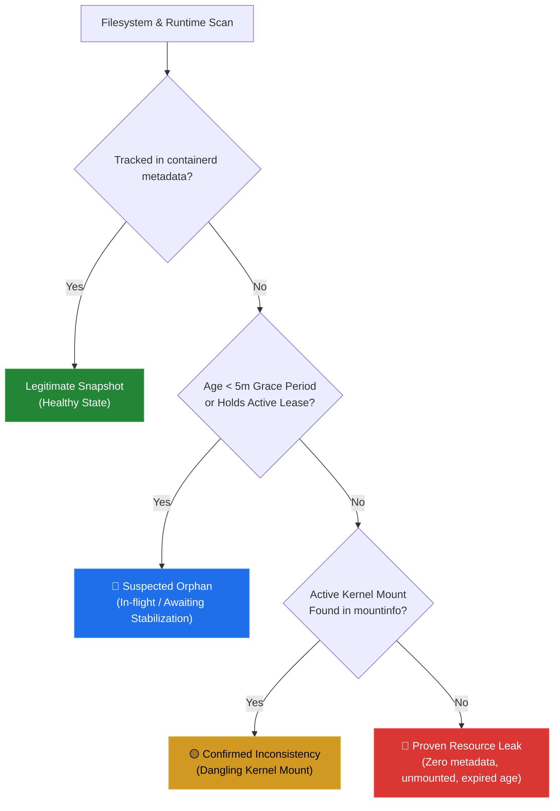

<div align="center">

# 🏹 Container Hunter

### *Find what your container runtime forgot.*

**A zero-overhead, read-only diagnostic tool that hunts down leftover container layers, orphaned snapshot directories, and dangling OverlayFS mounts on Linux hosts.**

[](https://github.com/drumilbhati/container-hunter/actions/workflows/ci.yml)
[](https://github.com/drumilbhati/container-hunter/releases)
[](go.mod)
[](LICENSE)
[](https://github.com/drumilbhati/container-hunter)
[](#-operator-safety-guarantee)

<br/>

```text
┌────────────────────────────────────────────────────────────────────────────────────────────────┐
│ CONTAINER HUNTER v1.0.0   ● READ-ONLY DIAGNOSTIC MODE                                          │
│                                                                                                │
│ ┌─ System Metrics ───────────────────────────────────────────────────────────────────────────┐ │
│ │ Disk Snapshots: 142 │ Runtime Keys: 138 │ Overlay Mounts: 12                                │ │
│ │ Wasted Storage: 3.42 GB │ Wasted Inodes: 48,210 │ Scan Duration: 6ms                        │ │
│ └─────────────────────────────────────────────────────────────────────────────────────────────┘ │
│                                                                                                │
│ [1] All   [2] Proven Leaks   [3] Inconsistencies   [4] Suspected Orphans                       │
│                                                                                                │
│ Category             Snapshot ID     Wasted Size    Inodes      Age         Mounts             │
│ ────────────────────────────────────────────────────────────────────────────────────────────── │
│ Proven Resource Leak 1048            2.10 GB        24,500      4d 6h       0                  │
│ Proven Resource Leak 1052            1.32 GB        23,710      2d 1h       0                  │
│ Confirmed Inconsist… ghost-8         0 B            0           N/A         0                  │
│ Suspected Orphan     1090            45.20 MB       812         1m 20s      1                  │
│                                                                                                │
│ Keys: [↑/↓/j/k] Navigate │ [Enter] Detailed Dossier │ [Tab/1-4] Filter │ [r] Re-scan │ [q] Quit│
└────────────────────────────────────────────────────────────────────────────────────────────────┘
```

</div>

---

## ⚡ The Problem

When container runtimes like `containerd` crash, experience abrupt kernel reboots, or encounter mount failures midway through cleanup, **the runtime's metadata database and the host filesystem drift out of sync.**

- **Invisible Disk Waste:** If `containerd` purges a database record but is killed before deleting the physical layer under `/var/lib/containerd/...`, disk space is leaked indefinitely.
- **Dangling Mounts:** If an unmount operation aborts, the Linux kernel keeps the OverlayFS mount active in `/proc/self/mountinfo`.
- **Standard CLI Blind Spots:** Tools like `ctr`, `crictl`, or `docker` only query internal state databases (`meta.db`). If an orphaned folder has no database record, **standard tools report 0 bytes used and miss the leak completely.**

**Container Hunter bridges this gap by cross-referencing Linux kernel mount tables and physical disk directories against runtime metadata.**

---

## 🆚 Why Built-In Tools Fall Short

| Scenario | `ctr` / `crictl` | `df` / `du` | Container Hunter 🏹 |
| :--- | :---: | :---: | :---: |
| Normal running containers | ✅ Visible | ❌ Uncategorized | ✅ Tracked & Verified |
| Orphaned snapshot directories | ❌ **Invisible** | ⚠️ Raw bytes only | ✅ **Flagged with ID, size & age** |
| Dangling kernel OverlayFS mounts | ❌ **Invisible** | ❌ Invisible | ✅ **Flagged with mount points** |
| Active containers in-flight | ✅ Visible | ❌ Uncategorized | 🛡️ **Protected (zero false alarms)** |
| Execution mode | Mutates/Deletes | Read-only | 🛡️ **Strictly 100% Read-Only** |

---

## 🎯 Three-Tier Anomaly Taxonomy

To eliminate false alarms during live container provisioning, Container Hunter classifies discrepancies into three distinct verification tiers:



| Classification | Meaning | Evidence Collected |
| :--- | :--- | :--- |
| 🔴 **Proven Resource Leak** | Untracked directory on disk with zero runtime metadata, zero active leases, zero mounts, and exceeds the safety grace period. | Exact disk path, wasted byte size, inode count, last modification time. |
| 🟡 **Confirmed Inconsistency** | An active kernel OverlayFS mount attached to a missing snapshot ID, or a phantom database key with no folder on disk. | Mount targets (`lowerdir`/`upperdir`/`workdir`), active mountpoints. |
| 🔵 **Suspected Orphan** | A folder present on disk but absent from metadata that was modified recently (< 5 minutes) or holds an active lease. | Age on disk, grace period countdown, active leases. |

---

## ✨ Features

- **Blazing Fast In-Process Scan:** Traverses kernel mountinfo and snapshot trees in milliseconds (typical scans complete in **< 10ms**).
- **Interactive TUI:** Built with [Bubble Tea](https://github.com/charmbracelet/bubbletea) and [Lip Gloss](https://github.com/charmbracelet/lipgloss). Filter anomalies, inspect full forensic dossiers, and trigger live rescans.
- **Automatic bbolt Resolution:** Non-blocking parser for containerd's internal `metadata.db` that resolves sequential directory numbers (`1`, `2`) back to their image layer hashes (`sha256:...`) without lock contention.
- **Headless & CI/CD Ready:** Use `--no-tui` for plain terminal summary tables or `--json` to pipe structured reports directly into `jq`, Datadog, or Grafana.
- **Zero External Daemons:** Compiles into a single self-contained, statically linked Go binary. No background services, no gRPC daemons, no sockets.

---

## 🚀 Quickstart & Installation

### Option 1: Download Precompiled Binary (Recommended)

Download the latest static binary for your architecture from the [Releases](https://github.com/drumilbhati/container-hunter/releases) page:

```bash
# Detect architecture (amd64 or arm64)
ARCH=$(uname -m | sed 's/x86_64/amd64/' | sed 's/aarch64/arm64/')
VERSION="1.0.1"

# Download and extract
curl -sSL "https://github.com/drumilbhati/container-hunter/releases/download/v${VERSION}/container-hunter_${VERSION}_linux_${ARCH}.tar.gz" | sudo tar -xz -C /usr/local/bin/

# Verify installation
container-hunter --version
```

### Option 2: Install via Go

```bash
go install github.com/drumilbhati/container-hunter/cmd/container-hunter@latest
```

### Option 3: Build from Source

```bash
git clone https://github.com/drumilbhati/container-hunter.git
cd container-hunter
go build -o container-hunter ./cmd/container-hunter
```

---

## 🕹️ Interactive TUI Navigation

Launch the interactive dashboard with elevated privileges *(required to inspect `/proc/self/mountinfo` and `/var/lib/containerd/...`)*:

```bash
sudo container-hunter
```

### Keyboard Shortcuts

| Shortcut | Description |
| :---: | :--- |
| `↑` / `↓` or `j` / `k` | Navigate the anomalies table |
| `Enter` | Open the **Forensic Dossier** for the selected snapshot |
| `Esc` | Close the dossier and return to the main table |
| `Tab` | Cycle through anomaly filter tabs |
| `1` | View **All** detected entries |
| `2` | Filter to **Proven Resource Leaks** only (🔴) |
| `3` | Filter to **Confirmed Inconsistencies** only (🟡) |
| `4` | Filter to **Suspected Orphans** only (🔵) |
| `r` | Trigger an immediate live **Re-scan** |
| `q` or `Ctrl+C` | Exit Container Hunter |

---

## 🤖 Headless & Automation Modes

### 1. Plain Terminal Summary (`--no-tui`)

Perfect for automated SSH execution, cron diagnostics, or shell logging:

```bash
sudo container-hunter --no-tui
```

```text
Running Container Hunter scan (read-only)...

=== Scan Summary ===
Duration:         8ms
Disk Snapshots:   142
Runtime Keys:     138
Overlay Mounts:   12
Wasted Storage:   3.42 GB (3670016000 bytes)
Wasted Inodes:    48210
Anomalies Found:  4

CATEGORY               SNAPSHOT ID   SIZE       INODES   AGE     REASON
--------               -----------   ----       ------   ---     ------
Proven Resource Leak   1048          2.10 GB    24500    4d6h    Unreferenced snapshot directory on disk...
Proven Resource Leak   1052          1.32 GB    23710    2d1h    Unreferenced snapshot directory on disk...
Confirmed Inconsistency ghost-8      0 B        0        N/A     containerd database tracks snapshot key...
Suspected Orphan       1090          45.20 MB   812      1m20s   Directory exists on disk but is absent from...
```

### 2. Structured JSON Output (`--json`)

Stream complete audit logs into external tooling or parse directly with `jq`:

```bash
# Output formatted JSON report
sudo container-hunter --json | jq .

# Query total wasted disk space in gigabytes
sudo container-hunter --json | jq '(.wasted_disk_space_bytes / 1073741824 | tostring) + " GB"'

# Extract all proven leak directory paths
sudo container-hunter --json | jq -r '.anomalies[] | select(.category == "Proven Resource Leak") | .path'
```

---

## ⚙️ Configuration & Flags

| Flag | Shorthand | Default | Description |
| :--- | :---: | :--- | :--- |
| `--socket` | `-s` | `/run/containerd/containerd.sock` | Path to containerd UNIX domain socket |
| `--snapshots-dir` | `-d` | `/var/lib/containerd/io.containerd.snapshotter.v1.overlayfs/snapshots` | Root directory for OverlayFS snapshots |
| `--mountinfo` | `-m` | `/proc/self/mountinfo` | Kernel mount table path |
| `--grace-period` | `-g` | `5m` | Time required before an unreferenced snapshot is flagged as a leak |
| `--no-tui` | — | `false` | Disable interactive TUI and print summary table to stdout |
| `--json` | — | `false` | Output results as structured JSON |
| `--version` | `-v` | `false` | Print version and exit |

---

## 🛡️ Operator Safety Guarantee

Container Hunter is designed from the ground up as a **strictly non-invasive, read-only diagnostic utility**:

> [!IMPORTANT]
> **Container Hunter will NEVER:**
> - Delete, unlink, or move any file or directory.
> - Call `umount` or modify kernel mount tables.
> - Send mutate, delete, or prune API requests to `containerd`.
> - Interrupt running containers or background worker tasks.

All forensic evidence is collected using read-only filesystem calls and read-only database transactions. Operators retain 100% control over remediation.

---

## 📋 Architecture & Documentation

- [System Architecture & Design Flow](docs/architecture.md) — Request lifecycle, internal packages, and orchestration diagrams.
- [Scope and Requirements](docs/scope-and-requirements.md) — Supported kernels, performance budgets, and interface contracts.
- [Problem Statement & Taxonomy](docs/problem-statement.md) — In-depth breakdown of container filesystem leakage mechanics.

---

## 🤝 Contributing

Contributions, bug reports, and feature requests are welcome!

1. Fork the repository.
2. Create your feature branch (`git checkout -b feat/my-feature`).
3. Ensure tests and builds pass (`go test -v ./... && go build ./...`).
4. Commit your changes following [Conventional Commits](https://www.conventionalcommits.org/) (`feat(scanner): add support for custom socket`).
5. Open a Pull Request.

---

## 📄 License

Container Hunter is licensed under the [MIT License](LICENSE). © 2026 Drumil Bhati.
