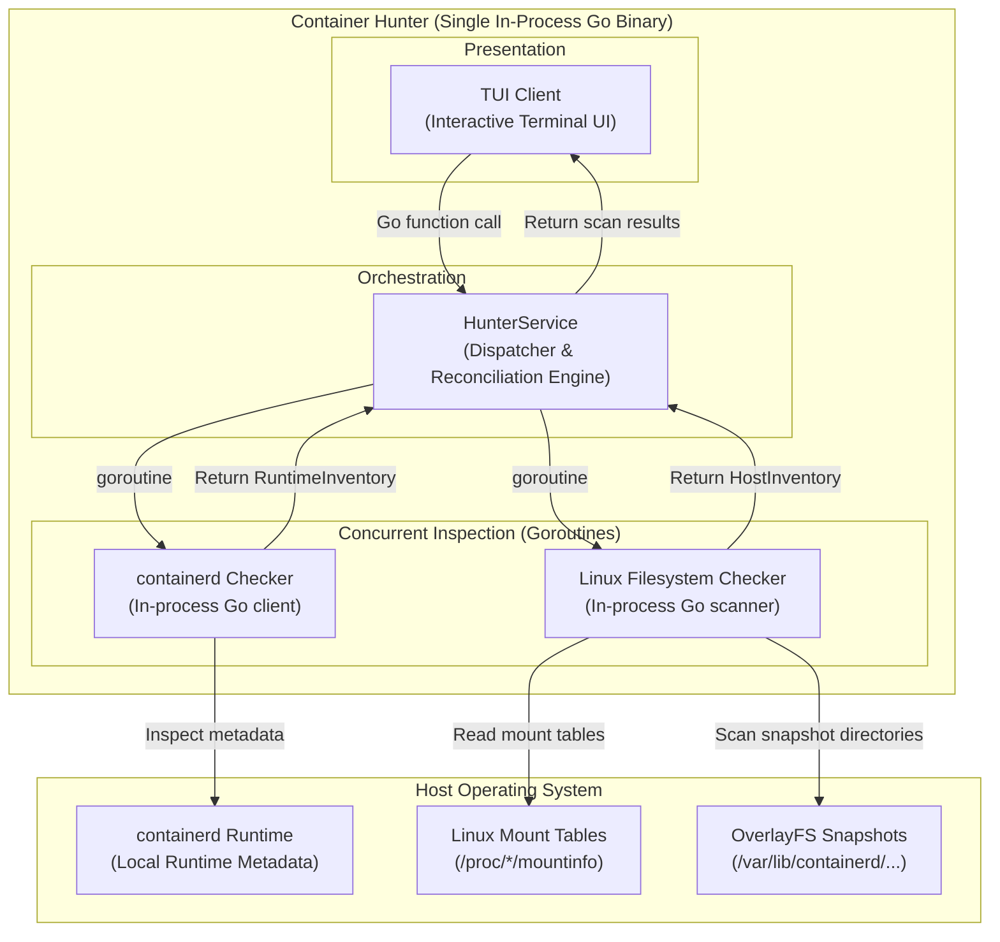
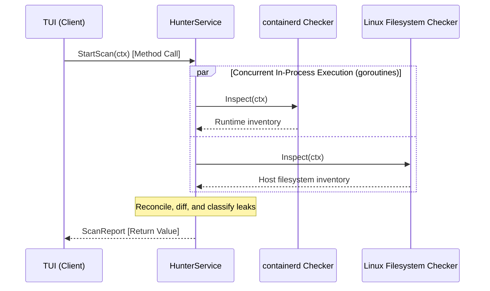

# System Architecture & Design

Container Hunter is compiled as a **single, lightweight Go binary** running entirely in-process on the local host. It avoids all internal IPC, gRPC, or socket-based service overhead, coordinating components via direct Go interfaces, method calls, and goroutines.

---

## High-Level Design (HLD)

---

## Sequence / Interaction Flow

---

## Component Responsibilities

| Component | Responsibility |
| :--- | :--- |
| **TUI (Client)** | Renders terminal views, captures user input, and triggers scans. Invokes `HunterService` via direct Go method calls. |
| **HunterService** | Single orchestration layer. Dispatches both checkers concurrently across goroutines, reconciles runtime metadata against filesystem state, calculates wasted space, and returns the combined report. |
| **containerd Checker** | Local inspection package. Gathers active containers, image layers, snapshot keys, and leases directly using the containerd Go library. |
| **Linux Filesystem Checker** | Local inspection package. Reads host mount tables (`/proc/*/mountinfo`) and scans physical snapshot directories (`/var/lib/containerd/...`) using standard Go filesystem libraries. |

---

## Key Design Principles

1. **Single In-Process Binary:** No separate background daemons, microservices, gRPC servers, or IPC sockets. Everything runs in a single Go process.
2. **Concurrent & Non-Blocking:** `HunterService` spins up lightweight goroutines (using `sync.WaitGroup` or `errgroup`) to run both checks simultaneously.
3. **Decoupled via Interfaces:** Checkers implement simple Go interfaces, ensuring zero coupling between the TUI and inspection internals.
