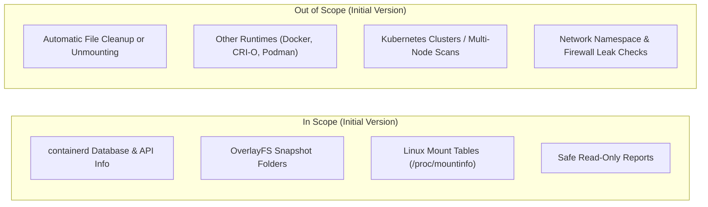

# Scope and Requirements

This document lays out what **Container Hunter** will do in its initial version (MVP) and what is planned for the future.

---

## 1. Supported Target Environment

- **Operating System:** Linux (Kernel 5.4 or newer; Kernel 6.x recommended).
- **Container Runtime:** `containerd` (v1.6.x or v1.7.x).
- **Storage Driver:** `overlayfs` (specifically inspecting `/var/lib/containerd/io.containerd.snapshotter.v1.overlayfs`).
- **Permissions Required:** Root access or elevated capabilities (`CAP_SYS_ADMIN` and `CAP_DAC_OVERRIDE`).

---

## 2. Scope Overview

---

## 3. Core Requirements

### Requirement 1: Collect Container Runtime Data
- **1.1:** Connect to `containerd` via its official API to list all active containers, running tasks, image layers, snapshot keys, and active locks.
- **1.2:** Build a clear tree map showing how snapshot layers relate to one another (parent-child hierarchy).

### Requirement 2: Inspect Host Filesystem and Mounts
- **2.1:** Scan `/var/lib/containerd/io.containerd.snapshotter.v1.overlayfs/snapshots/` to catalog all snapshot folders present on disk.
- **2.2:** Read Linux mount tables (`/proc/self/mountinfo` and `/proc/*/mountinfo`) to identify active OverlayFS mounts and their paths.

### Requirement 3: Compare System State (Reconciliation)
- **3.1:** Compare what `containerd` reports against what actually exists on disk and in mount tables to spot discrepancies.
- **3.2:** Double-check active locks and temporary files so containers currently being created or deleted aren't mistakenly labeled as leaks.

### Requirement 4: Collect Evidence
- **4.1:** For every detected issue, generate a detailed report with:
  - Exact folder path or mount point.
  - Snapshot ID.
  - Total disk space used (in bytes).
  - Number of files/inodes.
  - Active mounts (if any).
  - Time of check.
  - Explanation of why it's flagged (e.g., "Folder exists on disk but is missing from containerd database").

### Requirement 5: Calculate Wasted Disk Space
- **5.1:** Calculate total wasted storage caused by leftover snapshot folders.
- **5.2:** Accurately measure unique container modifications without double-counting shared base image layers.

### Requirement 6: Strict Read-Only Safety
- **6.1:** Never write to or modify files in `/var/lib/containerd`, `/proc`, or `/sys`.
- **6.2:** Never attempt to delete folders, remove files, unmount drives, or issue delete API calls.

---

## 4. Performance & Safety Goals

### Performance
- **Speed:** A full check on a system with up to 1,000 snapshots should take under 15 seconds.
- **Memory:** Memory usage must stay under 128 MB RAM.
- **System Impact:** Scanning should run quietly in the background without slowing down live containers.

### Reliability & Safety
- **Handle Live Changes:** Gracefully handle containers starting or stopping during a scan without crashing.
- **Double-Check Period:** Wait a few seconds (e.g., 5 seconds) before confirming a leak to give active container tasks time to finish.

### Reports & Privacy
- **Output Formats:** Output findings as JSON for scripts/tools and formatted tables for human reading.
- **Privacy Protection:** Redact sensitive environment variables or private folder paths from logs.

---

## 5. Future Ideas (Post-MVP)

- Support for other storage drivers (`devmapper`, `btrfs`, `zfs`, `stargz`).
- Support for Docker Engine (`dockerd`) and CRI-O.
- Detection of orphaned network namespaces (`/var/run/netns`) and leftover network interfaces.
- A background monitoring mode that exports metrics to Prometheus.

---

## Related Documentation

- [README](../README.md)
- [Problem Statement](problem-statement.md)

