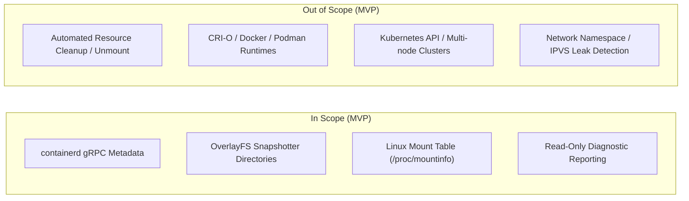

# Scope and Requirements

This document specifies the functional, non-functional, and operational requirements for **Container Hunter**, separating mandatory Minimum Viable Product (MVP) requirements from future architectural scope expansion.

---

## 1. Supported Target Environment

- **Operating System:** Linux (Kernel 5.4+ required; Linux 6.x recommended).
- **Target Runtime:** `containerd` (v1.6.x or v1.7.x).
- **Storage Driver / Snapshotter:** `overlayfs` (specifically inspecting `/var/lib/containerd/io.containerd.snapshotter.v1.overlayfs`).
- **Permissions:** Root execution or `CAP_SYS_ADMIN` + `CAP_DAC_OVERRIDE` capability set.

---

## 2. In-Scope vs. Out-of-Scope Capabilities

---

## 3. Mandatory MVP Functional Requirements

### FR-1: Runtime Inventory Collection
- **FR-1.1:** Must query `containerd` via its official gRPC client API to inventory all active containers, tasks, image manifests, content blobs, snapshotter keys, and active leases.
- **FR-1.2:** Must parse snapshot key hierarchies to build an in-memory parent-child lineage map.

### FR-2: Host State Inspection
- **FR-2.1:** Must recursively inspect `/var/lib/containerd/io.containerd.snapshotter.v1.overlayfs/snapshots/` to catalog all existing snapshot directories on disk.
- **FR-2.2:** Must parse `/proc/self/mountinfo` and `/proc/*/mountinfo` to extract active OverlayFS mount points, lowerdir/upperdir/workdir paths, and target mount destinations.

### FR-3: Cross-Layer State Reconciliation
- **FR-3.1:** Must perform set-difference and graph-matching operations between runtime inventory keys and host snapshot directories/mount points.
- **FR-3.2:** Must account for active leases and transient locks to prevent misclassifying in-flight creation/deletion operations as leaks.

### FR-4: Evidence Collection and Attribution
- **FR-4.1:** For every detected discrepancy, the system must produce an immutable evidence record containing:
  - Absolute host directory path or mount point.
  - Snapshot ID / hash.
  - Measured disk space usage (bytes).
  - Associated inode counts.
  - Active mount references (if any).
  - Timestamp of observation.
  - Reconciliation failure reason (e.g., "Directory present on disk, absent from containerd metadata DB").

### FR-5: Resource Impact Estimation
- **FR-5.1:** Must calculate net disk space consumed by orphaned snapshot directories.
- **FR-5.2:** Must accurately calculate OverlayFS upperdir disk usage without double-counting shared lowerdir image layers.

### FR-6: Read-Only Safety Invariant
- **FR-6.1:** Must execute with zero write operations to `/var/lib/containerd`, `/proc`, or `/sys`.
- **FR-6.2:** Must never issue `unlink`, `rmdir`, `umount`, or gRPC deletion calls under any circumstance.

---

## 4. Non-Functional Requirements

### NFR-1: Performance and Overhead
- **NFR-1.1:** Full reconciliation scan on a host with up to 1,000 snapshots must complete in under 15 seconds.
- **NFR-1.2:** Memory usage during scan must remain under 128 MB RAM.
- **NFR-1.3:** Scanning must utilize non-blocking I/O routines and avoid degrading live container workloads.

### NFR-2: Reliability and Safety
- **NFR-2.1:** The tool must handle concurrent container lifecycle state changes without panicking or producing unhandled exceptions.
- **NFR-2.2:** Transience buffers (e.g., re-verifying suspected orphans after a configurable delay of 5 seconds) must be enforced to prevent race conditions during active container creation/deletion.

### NFR-3: Usability and Output Integrity
- **NFR-3.1:** Results must be formatted as structured JSON for machine ingestion and clean tabular text for human operators.
- **NFR-3.2:** Output logs must redact sensitive environment variables or confidential path names.

---

## 5. Future Enhancements (Post-MVP)

- Support for additional snapshotters (`devmapper`, `btrfs`, `zfs`, `stargz`).
- Support for Docker Engine (`dockerd`) and CRI-O runtimes.
- Inspection of orphaned network namespaces (`/var/run/netns`) and host network interfaces.
- Optional interactive daemon mode with Prometheus metrics export.

---

## Related Documentation

- [README](../README.md)
- [Problem Statement](problem-statement.md)
